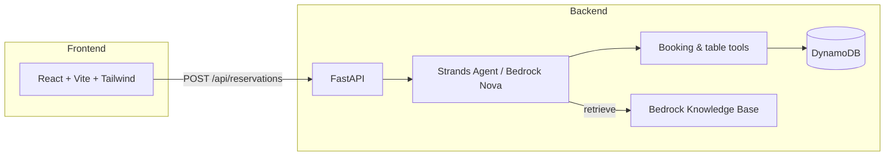

# AI-Powered Restaurant Reservation System

**Team:** Digital Hackers · **Event:** Capgemini AWS Gen AI Hackathon  
**Demo brand:** The Gourmet Grill — intelligent table booking with an AWS Bedrock agent.

## Overview

This project combines a **React** customer and staff experience with a **Python FastAPI** backend orchestrated by a **Strands Agents** reservation agent on **Amazon Bedrock**. Bookings and table assignments persist in **Amazon DynamoDB**; historical menus and reservation data can be queried via **Bedrock Knowledge Base** (RAG) through the agent `retrieve` tool.

## Architecture



## Repository layout

| Path | Description |
|------|-------------|
| `frontend/Gen AI FE/Gen AI FE/` | Guest UI: home, menu, reservations, table view, staff dashboard, wait status |
| `backend/restaurant-reservation-system/` | FastAPI, Strands agent, DynamoDB layer, agent tools, KB prerequisites |
| `backend/.../prereqs/kb_files/` | JSONL datasets for knowledge base ingestion |
| `backend/.../drafts/` | Hackathon notebooks and experiments (optional for demos) |

## Tech stack

- **Frontend:** React 18, TypeScript, Vite, Tailwind CSS, Axios  
- **Backend:** Python, FastAPI, Uvicorn, Pydantic, Boto3  
- **AI / AWS:** Strands Agents, Amazon Bedrock (`amazon.nova-lite-v1:0`), DynamoDB, Bedrock Knowledge Bases  

## Prerequisites

- Node.js 18+ and npm  
- Python 3.10+  
- AWS account with credentials configured (`aws configure` or environment variables)  
- IAM access for **Bedrock** (model + Knowledge Base as used in hackathon) and **DynamoDB**  
- Optional: Knowledge Base provisioned using scripts under `backend/restaurant-reservation-system/prereqs/`  

## Quick start

### 1. Backend

```bash
cd backend/restaurant-reservation-system
python -m venv .venv
# Windows: .venv\Scripts\activate
# macOS/Linux: source .venv/bin/activate
pip install -r requirements.txt
cp .env.example .env
# Edit .env with your AWS region and table name
python run_server.py
```

API runs at `http://localhost:8000`. Health check: `GET /health`.

### 2. Frontend

```bash
cd "frontend/Gen AI FE/Gen AI FE"
npm install
cp .env.example .env
npm run dev
```

Open `http://localhost:5173` and use **Reservations** to submit a booking (calls `POST /api/reservations/`).

## API endpoints

| Method | Path | Description |
|--------|------|-------------|
| `GET` | `/health` | Service health |
| `POST` | `/api/reservations/` | Create reservation via Bedrock agent + tools |
| `GET` | `/api/tables/` | Placeholder — table list (stub) |
| `GET` | `/api/guests/` | Placeholder — guest list (stub) |

## Agent capabilities

The **Reservation Orchestrator** agent can:

- Create, look up, and cancel bookings  
- Check table availability and assign tables (including window preference and bar alternatives)  
- Send notification messages (demo implementation logs to stdout)  
- Retrieve menu, layout, and historical data from the knowledge base  

Tool implementations live in `backend/restaurant-reservation-system/tools/`.

## Known limitations (honest demo scope)

- Staff dashboard and table floor plan use **mock data** in the UI.  
- Guest/table REST routes are stubs.  
- CRM, kitchen, POS integrations and no-show ML are placeholders.  
- Full Knowledge Base setup requires AWS resources (see `prereqs/knowledge_base.py`).  
- Running reservations requires valid AWS credentials and Bedrock access.  

## Resume highlights

Use these as a starting point and adjust for **your** contribution:

- Built a **Gen AI reservation orchestrator** on **Amazon Bedrock** with **tool calling** for bookings, table assignment, and operational queries.  
- Designed **DynamoDB** persistence for bookings and table slots with a repository layer in Python.  
- Delivered a **React/TypeScript** multi-role UI for guests and restaurant staff.  
- Integrated **FastAPI** with the agent pipeline for production-style REST intake.  
- Prepared **RAG** datasets and Bedrock Knowledge Base helpers for menu and historical reservation context.  

## Team & license

Developed for the Capgemini AWS Gen AI Hackathon by **Digital Hackers**.  
Confirm licensing and attribution with your team before public release.

## Publishing to GitHub

See [GITHUB_SETUP.md](./GITHUB_SETUP.md) for step-by-step instructions to create a repository and push this project safely (without committing secrets).
